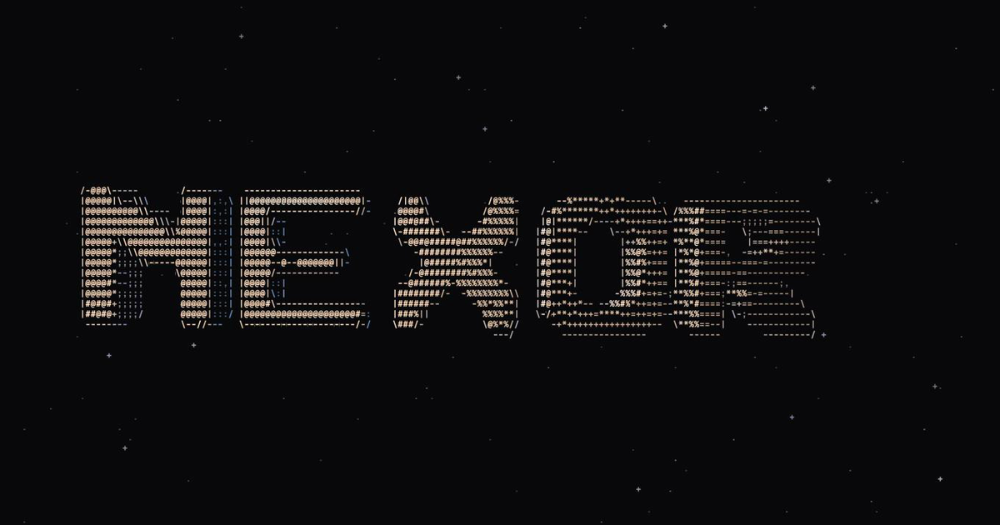

<div align="center">



<h1>plattnericus.dev</h1>

<p><strong>Portfolio of Nexor / Plattnericus.</strong><br />
A 3D world you fly through by scrolling, drawn entirely in text characters.</p>

<p>
  
  
  
  
  
  
  
</p>

<p>
  <a href="#the-page">The page</a> ·
  <a href="#nexor-grid">Nexor Grid</a> ·
  <a href="#rendering">Rendering</a> ·
  <a href="#performance">Performance</a> ·
  <a href="#configuration">Configuration</a> ·
  <a href="#seo-and-security">SEO and security</a> ·
  <a href="#development">Development</a>
</p>

</div>

<br />

Every visible thing on the site is a character. Headlines, project films, the 3D world behind them and the 404 page are all drawn as glyphs on a monospace grid, every frame, set in a typeface made for this site.

## The page

| Section | What happens |
| --- | --- |
| Loader | A three-digit counter in 3D characters next to a boot log. It only climbs when something has actually loaded (fonts, distance fields, project clips). At 100 the camera dives through the middle zero. |
| Hero | `NEXOR` as solid 3D letters, relit under the cursor. The cursor cuts glowing channels through the letters, which grow back behind it. Click anywhere and a shock ring of `/ | \ -` runs out through the characters and bends them. Scrolling flies the camera through the O. |
| About | One line, printed as ASCII lettering that flies together from every corner, next to an object made of characters. |
| Tools | Pinned. The camera circles the object, which changes shape for each of seven tools. Every name arrives with a different reveal than the one before. |
| Principles | Pinned. Four principles, one at a time, never the same reveal twice in a row. |
| Enter | Pinned. The name arrives as a speck and grows with every scroll step (an exponential zoom, so it never slows down) until the camera is inside the crossing of the X. The screen floods with characters, warms to orange, and opens from the middle into hyperspace. A magnification readout counts along. |
| Work | Pinned. Each project plays as a large colour ASCII film with outlines traced in `- / \| \` and a timeline in characters. Every cut is a different transition (static, wipe, iris, interlace, resolve, push), every name a different reveal. |
| All projects | A terminal-style listing with dotted leaders. On wide screens with a mouse, a monitor beside the list plays the film of the line under the cursor. |
| Contact | The flight ends at a giant `@`. The address is ASCII art too. |
| Footer | Links as `~/paths`, a live status line of the tab (uptime, cells drawn, frame rate, season, secrets found) and the name across the full width, lit from wherever the cursor is. |
| 404 | A small black hole with a lensed accretion disk. It slowly pulls the 404 in, cell by cell. Click to feed it. |

Behind everything runs a hyperspace starfield. Stars drift towards you, and scrolling throws them past as streaks of `- / | \` pointing away from the centre. The faster you scroll, the longer the streaks.

### The shell

Press <kbd>`</kbd> or <kbd>Ctrl</kbd>/<kbd>⌘</kbd> + <kbd>K</kbd>, or tap `~$` in the bar.

| Command | |
| --- | --- |
| `ls` | list the projects |
| `open <n>` | open a project by number or name |
| `cd <section>` | fly to about, tools, work, projects or contact |
| `stack`, `whoami`, `mail` | the short version |
| `warp` | full speed |
| `secrets` | how many you have found |

Tab completes and the arrow keys walk the history. Some commands are not on this list.

## Nexor Grid

The display face is not a stock font. It is generated by [`scripts/nexor-grid/build.py`](scripts/nexor-grid/build.py) (Python standard library only) and written straight to `app/fonts/NexorGrid.woff`: 64 glyphs, about 4 KB.

Every glyph is a pattern on a 5 x 7 grid of extended modules. Three rules turn the grid into outlines, so every edge runs at 0, 45 or 90 degrees and the ASCII renderer can trace it cleanly with `- / | \`:

1. An exposed outer corner is cut at 45 degrees.
2. An inner corner gets a small 45 degree fillet.
3. Two modules that only touch at a corner are joined by a 45 degree stroke.

```bash
python3 scripts/nexor-grid/build.py
```

Lowercase maps to the capitals, so the face is unicase. It sets the 3D wordmark, every ASCII headline, the loader digits, the zoom and the 404. Geist Mono draws the characters themselves and the small text.

## Rendering

```
scroll ──► camera path (Catmull-Rom between keys pinned to sections)
              │
              ▼
   ray marcher, one fragment shader ──► colour + coverage, 2x2 texels per cell
              │
              ▼
   ASCII pass ──► edges     - / | \
                  body      " .,:;-=+*%#@"
                  stars     . + *  and radial streaks
              │
              ▼
   fixed WebGL canvas behind the DOM

   2D canvases on top, same glyph grid:
   headlines (AsciiTitle) · zoom (ZoomWord) · project films (VideoAscii) · 404 (BlackHole)
```

- **One world, one shader.** Every scene sits at its own depth along `-z`. Bounding boxes skip zones, so each ray only evaluates what is near it.
- **Text as geometry.** Words are rasterised, turned into signed distance fields with an exact Euclidean distance transform, and extruded with rounded edges in the shader.
- **ASCII headlines.** Text is set in Nexor Grid, wrapped to its box, rasterised into cells and lit through a bevel. Outlines become `- / | \ _`. With a mouse, a magnifier follows the cursor over every headline: each cell under it shows the cell nearer the lens centre, so the type grows there without gaps or bigger glyphs. Seven reveals (sweep, scan, rain, assemble, dissolve, outline, radial): fixed ones per static headline, and titles that change pick a different one each time. Small text rotates between four styles too (decode, type, dots, wave). Rapid changes during fast scrolling are drawn at once, so nothing is ever left halfway.
- **Cuts.** The cursor's ray meets the front of the wordmark; each point along the way becomes a cone subtracted from the letters (smooth, up to twelve at once). The cut walls glow orange while fresh, then cool as the cone shrinks and the letters close.
- **Shockwaves.** A click adds a wave (up to three at once) to the ASCII pass: cells near the front sample the scene displaced outwards, and empty cells on the ring print a tangential line glyph.
- **The zoom.** The word is drawn into a mask at two samples per cell, every frame, at any magnification. Coverage gives the body, a Sobel pass the outline glyphs, and a cheap emboss the light. The zoom is exponential and lands exactly where the centre module of the X covers the screen.
- **Films.** Clips are shrunk to one pixel per cell, auto-levelled, and printed in their real colour. A Sobel pass draws strong edges as line glyphs. Light frames are inverted, so the page stays dark and the subject keeps the characters.
- **Black hole.** Per cell: point-mass lensing of a hashed starfield, a nearly edge-on disk with differential rotation and Doppler beaming, its far side lensed into arcs above and below the shadow, and the photon ring.
- **Narrow screens** widen the field of view up to a limit, then pull framing shots back.

## Performance

- 120 fps in every section on a 120 Hz display (worst frame around 10 ms, measured in Chrome on the development machine).
- All routes are prerendered static files.
- One shared GSAP ticker drives Lenis, the world and every canvas. Canvases only draw while they are visible. Headlines only redraw when they change.
- The world stops rendering while a fullscreen overlay covers it.
- Project clips are 384x288 H.264 without audio (1.3 MB in total), loaded one ahead, and cached for 30 days.
- `prefers-reduced-motion` gets a calm page: no intro, no scrambles, static scenes.

## Configuration

Everything about the site lives in [`lib/site.ts`](lib/site.ts): name, links, projects, tools, principles and colours. The address is never hard-coded anywhere else:

| Variable | Purpose |
| --- | --- |
| `NEXT_PUBLIC_SITE_URL` | canonical URL for metadata, sitemap, JSON-LD, `llms.txt` and `security.txt` |
| `VERCEL_PROJECT_PRODUCTION_URL` | used when the variable above is not set (Vercel sets it) |
| `NEXT_PUBLIC_CONTACT_EMAIL` | contact address |
| `GOOGLE_SITE_VERIFICATION` | Search Console verification tag |

Without any of them, the defaults in `lib/site.ts` apply.

### Adding a project

Add an entry to `projects` in `lib/site.ts` and a clip to `public/clips/`:

```bash
ffmpeg -i in.mp4 -vf "scale=384:288:flags=lanczos,fps=30" -an \
  -c:v libx264 -preset veryslow -crf 26 -pix_fmt yuv420p -movflags +faststart out.mp4
```

## SEO and security

| | |
| --- | --- |
| Markup | static HTML for every section, real text behind every ASCII headline (screen readers and crawlers read it) |
| Structured data | JSON-LD graph: Person, WebSite, ItemList of projects with their repositories |
| Generated | `sitemap.xml`, `robots.txt`, web manifest, Open Graph and Twitter images, `llms.txt`, `/.well-known/security.txt` (RFC 9116) |
| Headers | Content-Security-Policy (same origin only), HSTS, `nosniff`, `frame-ancestors 'none'`, Referrer-Policy, Permissions-Policy (camera for this origin only, nothing else) |
| Privacy | no cookies, no analytics, no third-party requests. Fonts are self-hosted. Only a list of found secrets is kept, in the visitor's `localStorage`. See `/privacy`. |

## Development

```bash
npm install
npm run dev
```

| Script | Does |
| --- | --- |
| `npm run dev` | dev server |
| `npm run typecheck` | `tsc --noEmit` |
| `npm run lint` | ESLint |
| `npm run build` | production build |
| `npm run check` | all three |

Append `?skip` to the URL to skip the intro. In development, `?season=winter` (or spring, summer, autumn) previews another season, and `window.__world` and `window.__lenis` are exposed.

```
app/
  page.tsx                sections, JSON-LD
  layout.tsx              fonts, metadata
  not-found.tsx           the black hole
  llms.txt/, .well-known/ generated text files
  privacy/                privacy notice
components/
  WorldCanvas, Loader     the 3D world and the way into it
  Hero, About, Skills, Principles, Enter, Work, Index, Contact, Footer
  Shell, Cinema, Secret   shell, fullscreen ASCII video, seasonal scenes
  Specimen, Screensaver   two more hidden things
  AsciiHeading, Lost      ASCII headlines, 404
lib/
  site.ts                 all content and configuration
  secrets.ts, seasons.ts  what has been found, season dates
  ascii/                  glyph grid, shapes, titles, zoom, films, black hole, season art
  world/                  renderer, shaders, text SDFs, camera path, starfield
scripts/nexor-grid/       the typeface generator
```

## Stack

| | |
| --- | --- |
| Framework | Next.js 16 (App Router, fully static), React 19, TypeScript |
| Motion | GSAP 3 with ScrollTrigger, Lenis on the GSAP ticker |
| Rendering | three.js `ShaderMaterial`s and render targets, Canvas 2D for the glyph grids |
| Type | Nexor Grid (own, generated, via `next/font/local`) and Geist Mono (SIL Open Font License, via `next/font`) |

<br />

<div align="center">
  <sub>Built by <a href="https://github.com/Plattnericus">Nexor / Plattnericus</a></sub>
</div>

<br />

<details>
<summary><sub>&nbsp;.&nbsp;</sub></summary>

<br />

You looked. There are thirteen, and `secrets` in the shell counts them.

<details>
<summary>Spoilers</summary>

<br />

| | How |
| --- | --- |
| Season | Type the current season's name anywhere on the page, or tap the line in the footer five times. A scene drawn in characters plays (a Christmas tree in winter, blossom in spring, a sunset in summer, falling leaves in autumn), and its weather stays on the site until the season ends. Each season can only be found while it lasts. |
| Konami | ↑ ↑ ↓ ↓ ← → ← → B A. Same scene. |
| Mirror | `mirror` in the shell. Your camera as live ASCII art, mirrored. It only starts after the browser asks. Nothing leaves the tab. |
| Reel | `reel` in the shell. Every project clip full screen, with cuts through static. The arrow keys skip. |
| Drop | Drag any picture or video onto the page. It turns into characters. It is read locally and never uploaded. Wheel or `+`/`-` changes the resolution, `c` toggles colour. |
| Singularity | `cd /dev/null` |
| Sudo | Try `sudo`. |
| Specimen | Type `nexor` anywhere, or `fc-list` in the shell. The site's own typeface, as a specimen you can type into. |
| Gravity | Click the name in the footer. Click again and it stands back up. |
| Screensaver | Leave the page alone for 45 seconds. |
| Dotfile | `ls -a` in the shell, then read what you find. |
| Jump | Press and hold on empty space. A ring of characters fills around the cursor while the stars are pulled in; when it closes, the page jumps to the next section through hyperspace. |
| Neofetch | `neofetch` in the shell. |

The console also has something to say.

</details>
</details>
